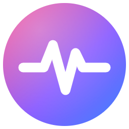

# PulseBrowser

Navegador para Windows baseado no **Chromium 152** (via Electron 44), com interface própria em português.



## Download

Baixe o instalador **PulseBrowser-Setup-1.0.0.exe** na página de [Releases](../../releases/latest) (Windows 10/11, 64 bits).

O instalador não tem assinatura digital, então o Windows pode mostrar "O Windows protegeu o computador". Clique em **Mais informações** e depois em **Executar assim mesmo**.

## Recursos

- **Abas completas**: arrastar para reordenar, fixar, silenciar, duplicar, mover para nova janela, reabrir abas fechadas (Ctrl+Shift+T), fechar outras/à direita e botão do meio para fechar.
- **Barra de endereço inteligente**: sugestões do mecanismo de pesquisa, histórico, favoritos e abas abertas ("Mudar para esta aba"), autocompletar em linha, Alt+Enter (nova aba) e Ctrl+Enter (completa `www.…com`).
- **Pulse Shield**: bloqueador de anúncios, rastreadores e mineradores com contador por página, exceções por site e uma lista ampliada opcional.
- **Janela anônima**: sessão separada na memória, apagada quando a última janela anônima é fechada.
- **Favoritos**: barra de favoritos com pastas, gerenciador (`pulse://bookmarks`), importação do Google Chrome e de arquivos HTML, exportação.
- **Histórico** (`pulse://history`) com busca, agrupado por dia, seleção múltipla.
- **Downloads** (`pulse://downloads`): pausar, continuar, cancelar, tentar de novo, progresso no ícone e na barra de tarefas do Windows.
- **Configurações** (`pulse://settings`): tema claro/escuro/sistema, cor de destaque, página inicial, mecanismo de pesquisa (Google, Bing, DuckDuckGo, Brave, Ecosia, Yahoo), limpar dados de navegação, permissões de sites, pasta de downloads, economia de memória, corretor ortográfico, extensões (beta) e "Tornar padrão".
- **Permissões por site**: câmera, microfone, localização, notificações e compartilhamento de tela, com prompts no estilo do Chrome.
- **Segurança**: cadeado e aviso "Não seguro", página de certificado inválido com opção "continuar mesmo assim", páginas internas isoladas (sites não conseguem abri-las nem acessar sua API), CSP nas páginas internas e sandbox em todas as abas.
- **Ferramentas**: DevTools do Chromium encaixadas na janela (F12), inspecionar elemento, código-fonte (Ctrl+U), localizar na página (Ctrl+F), zoom por site, imprimir, salvar como PDF, salvar página completa e capturar a tela da página.
- **Mais**: restauração de sessão com o histórico de cada aba, economia de memória (abas inativas entram em espera), visualizador de PDF, tela cheia de vídeos, picture-in-picture, login HTTP, páginas de erro amigáveis com um minijogo quando a internet cai, lista de atalhos na Jump List do Windows.

## Como usar

Requer Node.js 22 ou mais recente.

```bash
npm install
npm start
```

### Gerar o instalador do Windows

```bash
npm run dist
```

O instalador é gerado em `dist/PulseBrowser Setup 1.0.0.exe`.

> **Atenção:** o NSIS (usado para gerar o instalador) não funciona com caminhos de pasta muito longos (limite de 260 caracteres do Windows). Se o build falhar com `!include: could not open file`, copie o projeto para uma pasta curta (por exemplo `C:\pb`) e rode o comando lá.

Para gerar ícones novos a partir do logo: `npm run icon`.

## Atalhos de teclado

| Ação | Atalho |
| --- | --- |
| Nova aba / janela / janela anônima | Ctrl+T / Ctrl+N / Ctrl+Shift+N |
| Fechar aba / reabrir aba fechada | Ctrl+W / Ctrl+Shift+T |
| Próxima / anterior aba | Ctrl+Tab / Ctrl+Shift+Tab |
| Ir para a aba 1–8 / última | Ctrl+1…8 / Ctrl+9 |
| Barra de endereço | Ctrl+L, Alt+D ou F6 |
| Voltar / avançar | Alt+← / Alt+→ |
| Recarregar / sem cache | F5 / Ctrl+F5 |
| Localizar | Ctrl+F (F3 próximo) |
| Zoom | Ctrl++ / Ctrl+- / Ctrl+0 |
| Favoritar / barra de favoritos / gerenciador | Ctrl+D / Ctrl+Shift+B / Ctrl+Shift+O |
| Histórico / downloads | Ctrl+H / Ctrl+J |
| Imprimir / salvar / capturar | Ctrl+P / Ctrl+S / Ctrl+Shift+S |
| DevTools / código-fonte | F12 / Ctrl+U |
| Tela cheia | F11 |
| Limpar dados de navegação | Ctrl+Shift+Delete |

## Estrutura

```
src/
  main/       processo principal (janelas, abas, sessões, Shield, downloads, histórico, favoritos, IPC)
  preload/    pontes seguras: interface do navegador e páginas internas
  ui/         barra de abas e ferramentas (index.html) e sobreposição de pop-ups (overlay.html)
  pages/      páginas internas pulse:// (nova aba, histórico, favoritos, downloads, configurações, sobre, erro)
  shared/     ícones SVG compartilhados
  assets/     ícones do aplicativo
scripts/      geração de ícones
build/        recursos do instalador
```

Os dados do usuário (configurações, histórico, favoritos, sessão) ficam em `%APPDATA%\PulseBrowser`.

## Limitações conhecidas

- **Netflix, Spotify Web e outros serviços com DRM (Widevine)** não funcionam: o Electron não inclui o módulo Widevine.
- **Extensões do Chrome** têm suporte parcial (scripts de conteúdo e páginas de opções); pop-ups de extensões na barra de ferramentas e a Chrome Web Store não funcionam.
- Não há gerenciador de senhas, preenchimento automático de formulários nem sincronização entre dispositivos.
- A localização (geolocalização) pode não funcionar, pois o serviço do Google exige uma chave de API.
- O Pulse Shield bloqueia por domínio; não remove anúncios servidos pelo próprio site (como os anúncios em vídeo do YouTube, que ele apenas acelera e pula).
